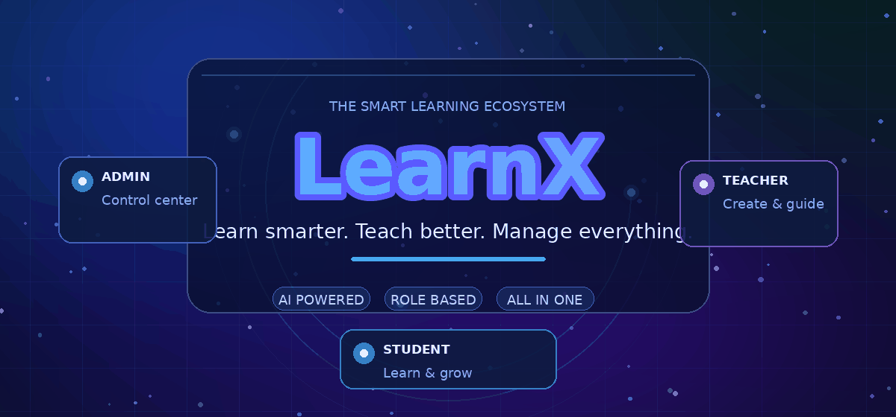
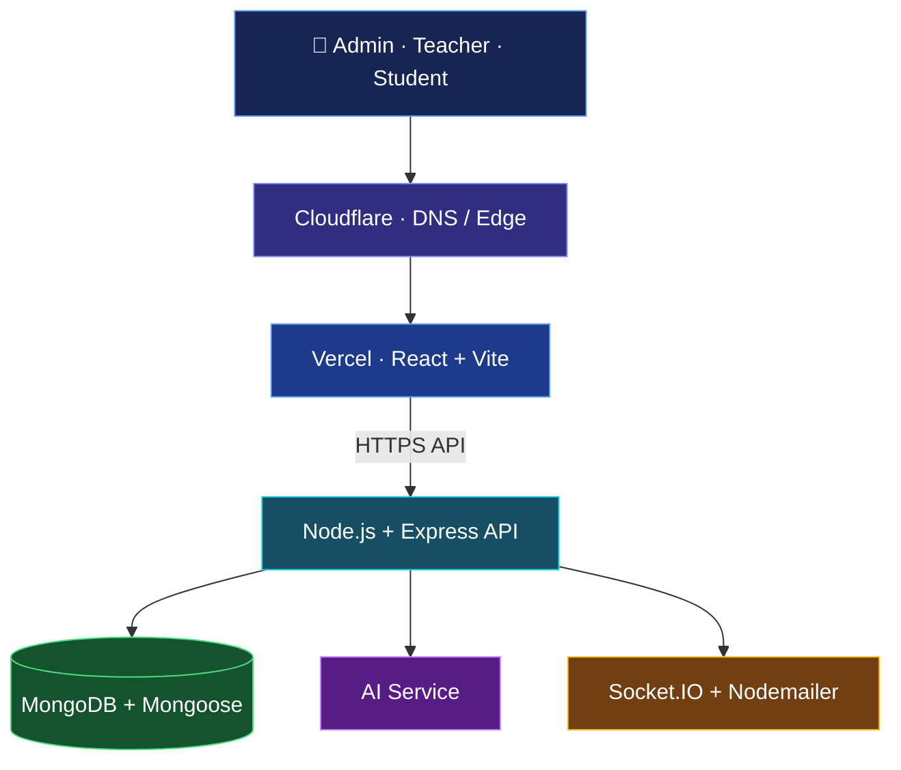

<div align="center">



<br/>

<a href="https://learnxplatform.qzz.io">
  
</a>


<br/><br/>


**An AI-powered Learning Management System connecting administrators, teachers, and students through one unified academic platform.**

[🌐 Live Platform](https://learnxplatform.qzz.io) · [✨ Features](#-the-learnx-experience) · [⚡ Tech Stack](#-technology-stack) · [🛠️ Setup](#️-run-locally)

</div>

---

## ✨ The LearnX experience

LearnX brings the everyday operations of an educational institution into one connected experience. Attendance, lectures, assignments, exams, fees, communication, and AI-assisted learning are organized into dedicated role-based workspaces.

<div align="center">

| 🛡️ ADMIN | 👨‍🏫 TEACHER | 🎓 STUDENT |
|:---:|:---:|:---:|
| **Oversee everything** | **Teach and track** | **Learn and grow** |
| Institution-wide control | Classroom workflows | Personalized learning |

</div>

## 🎭 Three portals. One ecosystem.

<table>
<tr>
<td width="33%" valign="top">

<h3>🛡️ Admin Portal</h3>

- Create and manage teacher accounts
- Generate unique teacher codes
- Add, update, and remove students
- Monitor student and teacher totals
- Oversee classes and assignments
- Manage fee information and payments
- Review and escalate support tickets
- Monitor attendance and institution analytics

</td>
<td width="33%" valign="top">

<h3>👨‍🏫 Teacher Portal</h3>

- Manage classes and students
- Create assignments, quizzes, and exams
- Publish announcements
- Generate learning content with AI
- Mark location-based attendance
- Review submissions and award marks
- Track student performance
- Manage leave requests and support tickets

</td>
<td width="33%" valign="top">

<h3>🎓 Student Portal</h3>

- Personalized academic dashboard
- Watch lecture videos
- Submit assignments
- Attend online exams and quizzes
- View attendance and performance reports
- Check timetable and announcements
- Track fees and payment status
- Apply for leave and raise tickets
- Use AI Tutor and view leaderboard rankings

</td>
</tr>
</table>

---

## 🚀 The LearnX experience

<details open>
<summary><strong>📊 Smart student dashboard</strong></summary>
A consolidated view of attendance, assignments, exam performance, timetable, fee status, and academic progress.
</details>

<details>
<summary><strong>🎥 Lecture management</strong></summary>
Teachers organize learning content, while students access lecture videos through their portal.
</details>

<details>
<summary><strong>📝 Assignment lifecycle</strong></summary>

- Teachers publish assignments with deadlines.
- Students submit work through the platform.
- Late submissions are identified using deadline rules.
- Teachers review submissions and award marks.
</details>

<details>
<summary><strong>🧠 Online exams and integrity measures</strong></summary>

- Students attempt scheduled exams and quizzes.
- Tab-switch activity is monitored during an exam.
- A warning appears after a detected tab switch.
- Repeated violations can trigger automatic submission.
- AI-assisted screen monitoring provides an additional signal to help identify suspicious activity.

> Monitoring signals support exam integrity; they should not be treated as infallible proof of misconduct.
</details>

<details>
<summary><strong>📍 Location and selfie-based attendance</strong></summary>

- Attendance workflows support location capture and selfie/photo verification.
- Student records can distinguish full-day, half-day, and lecture-level attendance.
- Teachers also have a location-based daily attendance workflow.
- Attendance records feed into dashboards and reports.
</details>

<details>
<summary><strong>🤖 AI Tutor and teacher AI assistant</strong></summary>

- Students ask academic questions and receive AI-generated explanations.
- Students can attach an image to explain a doubt or problem.
- Teachers can ask topic-related questions.
- Teachers can generate draft quizzes, exams, and assignments by entering a topic.
- AI-generated content can be reviewed before use.
</details>

<details>
<summary><strong>🎫 Support tickets and escalation</strong></summary>
Students can raise support tickets, and teachers can review and resolve them. Tickets that remain unresolved for **24 hours** are escalated to the Admin for visibility and follow-up.
</details>

<details>
<summary><strong>🔔 Notifications and announcements</strong></summary>
Notifications and sound alerts help users stay informed about academic activities and platform updates. Teachers can publish announcements for students.
</details>

<details>
<summary><strong>📅 Timetable, leave, and sprint plans</strong></summary>
Students can view their timetable, students and teachers can submit leave requests, and seven-day sprint plans help organize focused learning or work.
</details>

<details>
<summary><strong>🏆 Leaderboard and academic analytics</strong></summary>
Students can view leaderboard rankings. Teachers can review student and subject-level performance, while admins can monitor institution-wide activity and attendance trends.
</details>

<details>
<summary><strong>💳 Fees, profiles, search, and themes</strong></summary>
Students can view fee details and payment status and use the available payment workflow. Search helps users find relevant platform information. Users can update permitted profile details and choose light or dark themes.
</details>

---

## ⚡ Technology stack

<div align="center">


</div>

| Layer | Technologies |
|---|---|
| Frontend | React 18, TypeScript, Vite |
| Styling & UI | Tailwind CSS, shadcn/ui, Radix UI |
| Animations | Framer Motion |
| Routing | React Router |
| Data & UI state | TanStack React Query |
| Forms & validation | React Hook Form, Zod |
| Charts | Recharts |
| Backend | Node.js, Express.js, TypeScript |
| Database | MongoDB, Mongoose |
| Authentication | JWT, bcryptjs |
| Real-time communication | Socket.IO |
| Email | Nodemailer |
| File uploads | Multer |
| AI integration | Google Generative AI SDK |
| Deployment & domain | Vercel, Cloudflare |

---

## 🏗️ Architecture at a glance



**Deployment note:** Cloudflare manages the domain/DNS layer and Vercel serves the deployed frontend. The API server and database are deployed/configured separately for the production environment.

## 🔐 Authentication and access control

LearnX uses role-based access so each user can access only the features permitted for their role.

1. An administrator creates a teacher account and assigns a unique teacher code.
2. The teacher signs in using the assigned credentials.
3. An administrator or teacher creates a student account.
4. The student receives login details through the configured email service.
5. Backend middleware verifies authenticated requests.
6. Role-based middleware checks access to protected resources.

The backend includes JWT utilities, password hashing, authentication middleware, role middleware, and request validation.

## 🗂️ Project structure

```text
LearnX/
├── frontend/
│   ├── public/
│   ├── src/
│   │   ├── assets/
│   │   ├── components/
│   │   ├── pages/
│   │   ├── hooks/
│   │   ├── integrations/
│   │   └── ...
│   ├── package.json
│   └── vite.config.ts
│
├── learnx-backend/
│   ├── src/
│   │   ├── auth/
│   │   ├── config/
│   │   ├── controllers/
│   │   ├── middleware/
│   │   ├── models/
│   │   ├── routes/
│   │   ├── utils/
│   │   ├── app.ts
│   │   └── server.ts
│   ├── uploads/
│   └── package.json
│
└── README.md
```

## 🛠️ Run locally

### Prerequisites

- Node.js 18+
- npm
- MongoDB instance (local or MongoDB Atlas)
- Git

### 1. Clone the repository

```bash
git clone <YOUR_REPOSITORY_URL>
cd LearnX
```

### 2. Start the frontend

```bash
cd frontend
npm install
npm run dev
```

Vite displays the local development URL in the terminal (commonly `http://localhost:5173`).

### 3. Configure and start the backend

Open a second terminal:

```bash
cd learnx-backend
npm install
```

Create a `.env` file inside `learnx-backend/` and add the variables required by your backend configuration.

```env
NODE_ENV=development
PORT=5000
MONGODB_URI=your_mongodb_connection_string
JWT_SECRET=your_long_random_secret
```

Add any additional credentials required by enabled integrations, such as email, AI, OAuth, or file-storage services. **Never commit real secrets.**

Start the backend:

```bash
npm run dev
```

### 4. Production build

Frontend:

```bash
cd frontend
npm run build
```

Backend:

```bash
cd learnx-backend
npm run build
npm start
```

## 🌍 Deployment and SEO

The live platform is available at **[learnxplatform.qzz.io](https://learnxplatform.qzz.io)**.

| Service | Purpose |
|---|---|
| Vercel | Frontend hosting and deployment workflow |
| Cloudflare | Domain DNS management and available edge/security services |
| MongoDB | Application data storage through the backend |
| Environment variables | Production secrets and service credentials |

SEO-related work includes page titles and meta descriptions, search-friendly page content, sitemap and robots configuration, semantic HTML, heading structure, and Google Search Console monitoring.

> Search indexing and ranking are controlled by search engines and can change over time.

## 🛡️ Security practices

The backend includes or is structured to support:

- JWT-based authentication
- Password hashing with bcryptjs
- Role-based route protection
- Request validation
- Centralized error handling
- Security headers through Helmet
- Rate limiting
- Environment-based secret management
- Controlled file-upload handling

For production, use HTTPS, keep dependencies updated, validate uploaded files, and never expose private credentials in frontend code or Git history.

## 🧭 Potential future improvements

- More granular permission management
- Expanded automated test coverage
- Advanced audit logs for administrative actions
- Deeper learning recommendations based on student progress
- Further accessibility improvements
- Additional reporting and export options
- Performance monitoring and load testing

---

<div align="center">


### **Learn smarter. Teach better. Manage everything in one place.**

<a href="https://learnxplatform.qzz.io">
  
</a>

</div>
